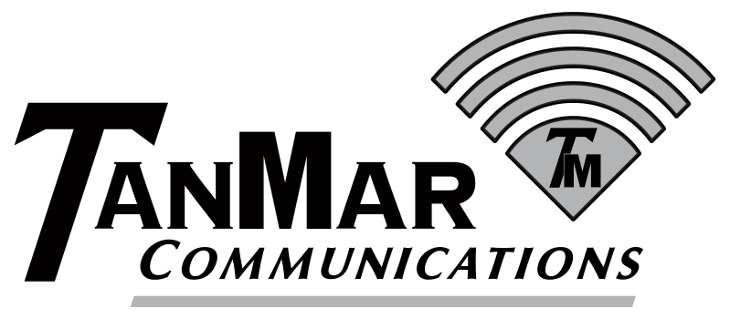

[← Journal home](../README.md) · [Portfolio](https://traceportfolio.netlify.app/)

# TanMar Safety Platform

August 2026 · AI-assisted application modernization · In progress

## Project summary

I started the TanMar Safety Platform in **August 2026** to bring a legacy safety-training application and several smaller HR applications into one bilingual web platform. The work combines requirements analysis, application modernization, database redesign, access controls, and verification.

Core workflows are implemented in the test environment. Production hardening is still underway, so this entry describes development progress rather than a completed production rollout. Employer source code and data remain private; the [public case study](https://traceportfolio.netlify.app/case-studies/tanmar-safety-platform) provides the approved overview.

## Objective and context

The objective is to consolidate employee training and related administrative work while preserving the business rules and historical records the existing applications depend on. The legacy Xojo training application, formerly called SafetyExam, supplies a substantial part of the behavior being analyzed and modernized. TanMar Safety Platform is the broader name because the work also incorporates smaller HR applications.

The employee side covers assigned training, instructional media, randomized exams, signatures, results, retakes, and completion tracking. Management workflows include employee administration, role- and location-scoped dashboards, announcements, training maintenance, reporting, exports, and annual scheduling.

## Directing AI-assisted development

I use Codex as an AI development partner. I define the problem, document requirements, guide architectural and implementation decisions, investigate discrepancies, and evaluate the resulting application against testable product contracts. AI-assisted implementation is part of the process, and my responsibility is to make the intended behavior clear and check the results.

Modernization starts with understanding the existing systems. I reconcile observed behavior with legacy source, database evidence, and business requirements to establish what the consolidated platform must preserve. This gives development and review a shared reference instead of relying on assumptions about how training should work.

## Design decisions

The platform uses **Python, FastAPI, PostgreSQL, Svelte, and TypeScript**. Several decisions shape the implementation:

- **Separate responsibilities.** Domain rules, API contracts, persistence, and frontend concerns are organized separately to support testing and maintainability.
- **Preserve historical relationships.** The database redesign accounts for training results, signatures, employee obligations, and bilingual relationships. Transactional migrations and explicit database-target checks provide safeguards around data changes.
- **Make completion rules explicit.** English and Spanish variants stay consistent across assignments, attempts, results, and completion credit. Scored exams and media-only training have distinct score and signature requirements.
- **Enforce access on the server.** Authorization reflects employee, management, and administrator responsibilities, including role and location scope.
- **Evaluate complete workflows.** Dashboard and Training Matrix improvements address queries, filtering, transport, resource loading, and rendering while preserving search, keyboard, print, and export behavior.

## Verification and current outcome

Verification combines Python unit and contract tests, frontend component and build-contract tests, and Playwright workflow coverage. Feature acceptance includes PostgreSQL-backed checks so database-dependent behavior is exercised against the platform's database system. Documented requirements and verification evidence guide acceptance of AI-assisted changes.

Core employee, management, reporting, and training workflows are implemented in the test environment. That is a meaningful development milestone, with operational acceptance still ahead. Current work focuses on operational hardening, portable deployment configuration, and final physical-device and accessibility acceptance before production rollout.

## Lessons and next steps

This work reinforces that modernization requires more than replacing a user interface. Historical records, completion rules, organizational boundaries, and reporting behavior all need explicit treatment. A visually correct screen is only one part of evaluating a workflow.

AI-assisted development also makes precise requirements and verification central to my role. The next steps are to continue the hardening work, complete device and accessibility acceptance, and evaluate production readiness against the documented requirements.

---

[← Journal home](../README.md) · [Portfolio](https://traceportfolio.netlify.app/)
