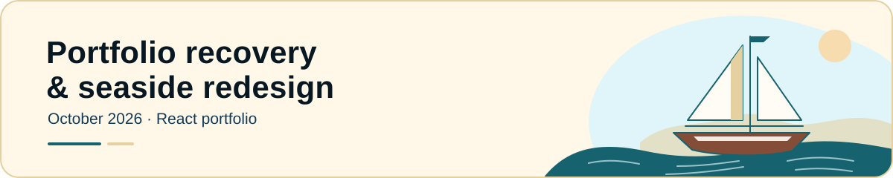
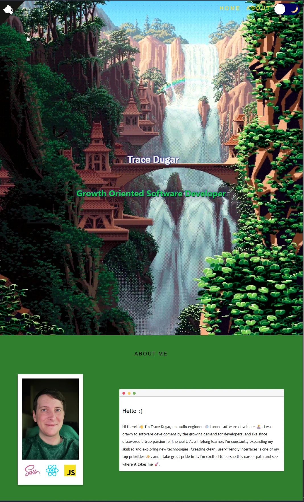
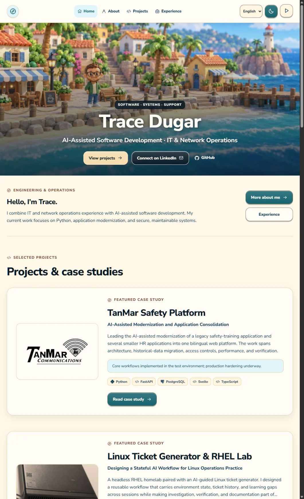

[← Journal home](../README.md) · [Portfolio](https://traceportfolio.netlify.app/)

<picture>
  <source media="(prefers-color-scheme: dark)" srcset="../assets/entries/portfolio-refresh-dusk.svg">
  <source media="(prefers-color-scheme: light)" srcset="../assets/entries/portfolio-refresh-day.svg">
  
</picture>

# Portfolio recovery & seaside redesign

October 2026 · React portfolio recovery and redesign

**[Visit the portfolio](https://traceportfolio.netlify.app/)** · [Explore the source](https://github.com/traceadugar/portfolio)

## Objective

Recover my existing portfolio, restore a maintainable deployment from my current GitHub account, and bring its presentation up to date with my IT experience and AI-assisted development projects.

This is a working web project: a bilingual React site with a custom seaside interface, project galleries, experience timeline, and public development evidence.

## Context

I lost access to my previous GitHub account after losing access to its two-factor authentication. That made recovering the portfolio and establishing a reliable home for its source the first priority.

The editable portfolio was recovered and connected to [my current repository](https://github.com/traceadugar/portfolio). Netlify now builds and publishes its `main` branch. Original history and earlier project screenshots were preserved, keeping the work useful even where old hosted demos and their dependent APIs had retired.

I worked with **Codex** throughout the recovery and redesign. I set the visual and product direction, reviewed iterations, and requested refinements; Codex performed implementation and verification work. That collaboration is part of the project, and I do not present the AI-generated implementation as independently hand-written code.

## Design and implementation

### One seaside visual system

I wanted a miniature California seaside town to give the site a recognizable personality while keeping the professional material easy to read. The approved animated artwork became the basis for the rest of the interface.

Day mode uses warm sand surfaces, teal controls, and terracotta accents. Dusk uses ocean and violet surfaces with lantern gold and lavender accents. Typography, rounded icons, project cards, About, and the timeline carry that same visual language across the site.

### Synchronized lighting and motion

The ocean continues moving when a visitor changes the theme. Day and dusk are packed into a single video and rendered through one canvas, so both scenes share the same wave position.

A shared 1.2-second blend drives the scene lighting and page colors together. Reversing the switch starts from the current blend instead of restarting the transition. Pausing freezes the waves while still allowing a lighting change; reduced-motion mode uses static posters.

### Content and navigation

English and Japanese content use matching project identities and experience order, with translated navigation, dates, gallery controls, and accessibility labels. The language buttons retain their native names: `English` and `日本語`.

The timeline now reads newest first. About routing, direct page visits, section navigation, and mobile layouts were refined. Archived projects keep screenshots and surviving repository links, while retired demo buttons were removed. Current entries distinguish ongoing development from completed historical work.

## Cleanup and verification

The existing React foundation was retained so recovery could remain incremental. Unused layout utilities and the old alternating timeline styles were removed. WebP thumbnails, locally hosted fonts and icons, cached content, and deferred project details reduce unnecessary transfers and loading work.

Accessibility provisions include a skip link, visible keyboard focus, labelled controls, large touch targets, and galleries with arrow-key navigation, Escape dismissal, and focus restoration. Palette tests check contrast through the lighting transition, including text and button states.

Regression tests cover routing, localization, timeline order, galleries, saved preferences, recoverable data errors, synchronized lighting, and reduced-motion fallbacks. Production builds and desktop/mobile browser checks preceded publication, followed by confirmation of the live Netlify deployment. These checks document specific behavior; they do not constitute an independent accessibility audit or a measured performance score.

## Before and after

View the homepage before and after

Before: the original homepage. Select the image to view it at full size.

After: an October 2026 capture of the published seaside homepage. Select the image to view it at full size.

## Lessons and next steps

The strongest improvement came from treating recovery, content accuracy, usability, and visual design as connected work. A distinctive scene needed consistent page colors and dependable navigation to feel complete.

My maintenance priorities are to keep project status and evidence current, preserve both language versions, and rerun relevant checks before publishing. A future toolchain migration can be evaluated separately, with its own verification rather than being folded into this recovery.

---

[← Journal home](../README.md) · [Portfolio](https://traceportfolio.netlify.app/)
