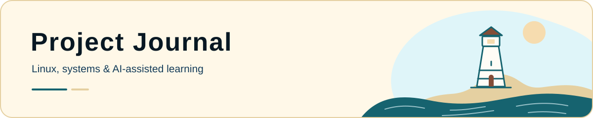

<picture>
  <source media="(prefers-color-scheme: dark)" srcset="assets/journal-dusk.svg">
  <source media="(prefers-color-scheme: light)" srcset="assets/journal-day.svg">
  
</picture>

# Project Journal

A working record of what I build, investigate, and learn: AI-assisted applications, a Godot simulation, a bilingual portfolio, a physical RHEL homelab, and practical scripting.

I'm **Trace Dugar**. I've worked in IT since **September 2023**, across network operations, field support, troubleshooting, and technical documentation. This journal connects that experience with my growing work in AI-assisted development, systems automation, and cloud security.

**[Portfolio](https://traceportfolio.netlify.app/)** · [GitHub profile](https://github.com/traceadugar) · [LinkedIn](https://www.linkedin.com/in/tracedugar/)

## Start here

| If you're interested in… | Read |
| --- | --- |
| AI-assisted application modernization | [TanMar Safety Platform](August%2026/TanMarSafetyPlatform.md) · In progress |
| Prompting-only game development | [Aquarium](September%2026/Aquarium.md) · In progress |
| Interface design, recovery, and deployment | [Portfolio recovery & seaside redesign](October%2026/PortfolioRefresh.md) |
| Linux infrastructure and troubleshooting | [Headless RHEL server](March%2026/RHELServer.md) and [recorded ticket resolutions](May%2026/LinuxTicketResolutions.md) |

## Entries · 2026

Newest months first. Dates mark when the work began or took place; ongoing entries describe development progress.

| Month | Entry | What it covers |
| --- | --- | --- |
| **October** | [Portfolio recovery & seaside redesign](October%2026/PortfolioRefresh.md) | React recovery, synchronized lighting, bilingual usability, and deployment |
| **September** | [Aquarium](September%2026/Aquarium.md) · In progress | Godot simulation, prompting-only development, context, and verification |
| **August** | [TanMar Safety Platform](August%2026/TanMarSafetyPlatform.md) · In progress | AI-assisted modernization, training workflows, access controls, and verification |
| **May** | [Linux ticket practice: two recorded resolutions](May%2026/LinuxTicketResolutions.md) | Account troubleshooting, least privilege, and retained evidence |
| **April** | [Linux Admin Ticket Queue](April%2026/LinuxAdminTicketQueue.md) | Stateful AI-guided practice, careful diagnosis, and resolution notes |
| **April** | [PaleHorse intro script](April%2026/introScript.md) | A Bash welcome screen for the Linux lab |
| **March** | [Headless RHEL server](March%2026/RHELServer.md) | Repurposed hardware, networking, SSH, and setup troubleshooting |
| **March** | [PowerShell personalization](March%2026/PowershellUI.md) | Syntax colors, prompt context, and command completion |
| **February** | [PC build](February%2026/PC%20Build.md) | Component choices, assembly, airflow, and lessons learned |
| **January** | [Why I started this journal](January%2026%20/tueThe27th.md) | The journal's origin and how my direction has developed |

## Go deeper

The journal keeps the build notes and learning process. My [portfolio](https://traceportfolio.netlify.app/) brings the work together with public case studies for [TanMar](https://traceportfolio.netlify.app/case-studies/tanmar-safety-platform), [Aquarium](https://traceportfolio.netlify.app/case-studies/aquarium), and the [Linux lab](https://traceportfolio.netlify.app/case-studies/linux-ticket-queue), including retained development evidence where available.

For the implementation details, read the [ticket simulator's original context file](April%2026/context_file/context.md) or the [PaleHorse Bash source](April%2026/intoScript/intro.sh).

I use AI for guidance, implementation, and review, depending on the project. Goals, simulated scenarios, and examples in these notes describe their intended scope; completed work is identified through the results and evidence available for it.

---

Build something useful. Understand why it works. Leave good notes.
