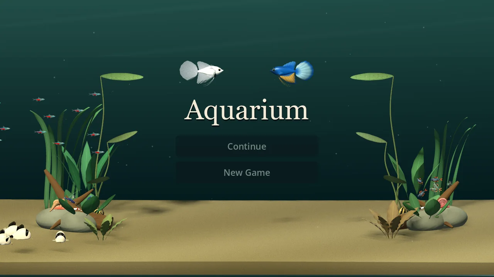

[← Journal home](../README.md) · [Portfolio](https://traceportfolio.netlify.app/)

<picture>
  <source media="(prefers-color-scheme: dark)" srcset="../assets/entries/aquarium-dusk.svg">
  <source media="(prefers-color-scheme: light)" srcset="../assets/entries/aquarium-day.svg">
  
</picture>

# Aquarium

September 2026 · Godot simulation and AI workflow · In progress

## Overview

Aquarium is an ongoing Godot game and an experiment in building and maintaining a substantial project through prompting alone. I started it in September 2026 under 964 Concepts. The game gives the experiment a concrete purpose: make a calm miniature world that is enjoyable to observe, with persistent inhabitants and recorded histories.

My role is product direction, observation, playtesting, and critique. AI agents perform the implementation, including code, configuration, models, editor changes, debugging, tests, documentation, and Git operations. I deliberately do not make manual project edits.

October 2026 development preview. Select the image to view it at full size.

## Objective

The product goal is observation-first artificial life, without chores, scores, or an economy. Movement, habitat use, and individual continuity need to make watching the world rewarding.

The workflow goal is to explore whether scoped prompts, durable context, and independent review can support sustained development across sessions. A playable experience provides feedback that a convincing generated answer cannot: I can see whether a fish moves naturally, whether a change damages another behavior, and whether the result fits the intended game.

## Approach and key decisions

I provide references, screenshots, logs, and feedback, then ask agents to investigate or make bounded changes. Written scopes and acceptance criteria help turn observations into work that can be reviewed. Specialized responsibilities cover architecture, persistence, behavior, performance, and evidence review.

Durable documentation carries decisions between sessions. Agents begin with governance and current state, then follow a context router to the relevant subsystem and contract. At an October 10 documentation checkpoint, mandatory startup reading fell from 5,228 to 2,543 whitespace-separated words: a **51.36% reduction** in that historical reading set. This was not a measurement of tokens, cost, productivity, or model reliability.

A separate boundary protects the saved world. Persistent inhabitants carry identity, traits, motion state, and recorded histories. Save handling validates a complete candidate before adoption, uses staged writes and backups, and refuses unsupported future formats. The living title scene uses disposable presentation creatures with independent randomness and no saved individual histories. Its species ensemble does not expand the persistent aquarium roster, which currently contains harlequin rasboras.

## Verification: a foraging example

On October 11, I requested a more readable corydoras sequence: reach the sand with the mouth, disturb it, and transition into a short swim. Implementation and independent checks exposed particle movement and turning defects. Corrections also accounted for the fish’s body and fins during turns and settling.

A focused development fixture recorded **458 passing foraging checks**. An unchanged shared-area departure test also passed for all six fish. Preserved reports, source inventories, and an independent correspondence review connect those historical results to the corrected sequence.

These checks do not establish universal collision clearance or complete species behavior. The public case study includes a four-second diagnostic close-up using a separate camera and an extended foraging visit; it illustrates the sequence rather than a normal gameplay session or a performance benchmark.

## Tradeoffs and lessons learned

AI implementation still needs clear ownership and review. Passing a focused check does not close unrelated behavior, visual, or performance questions. Source and build identity matter, and failed checks remain part of the evidence.

The preview includes an optional C++ fin backend with a GDScript fallback. I keep changes in scene workload separate from implementation gains when interpreting performance results; broader acceptance remains ongoing.

The most useful lesson so far is to connect prompts to observable behavior, preserve decisions across sessions, and match each claim to the evidence that actually supports it. Geometry checks help review, but visual and motion acceptance still require my judgment.

## Current status and next steps

Aquarium remains a development preview. Group routing for celestial pearl danios is unfinished. Next work includes behavior corrections, broader contact and movement verification, visual refinement, and performance acceptance. Both the game and the development experiment are ongoing.

[Read the public case study and development evidence](https://traceportfolio.netlify.app/case-studies/aquarium).

---

[← Journal home](../README.md) · [Portfolio](https://traceportfolio.netlify.app/)
